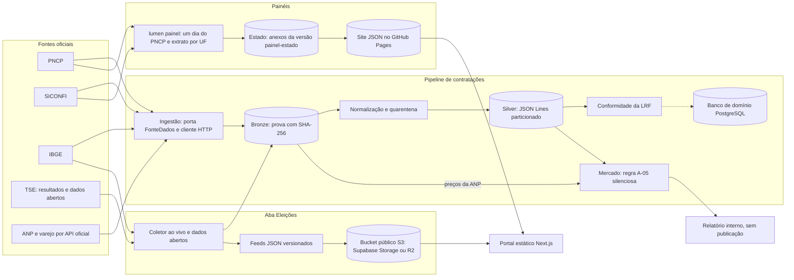

# Arquitetura

Fonte principal: [DOC-04 Arquitetura](https://github.com/Dracon-46/FalkyriaLumen/blob/main/docs/DOC-04_Arquitetura.docx)
(versão 1.1), complementada pelas ADRs em
[`docs/adr/`](https://github.com/Dracon-46/FalkyriaLumen/blob/main/docs/adr/README.md). Os diagramas
oficiais (contexto, containers, camadas, conectores, estados do indício, eleições e painéis) estão em
[`docs/diagramas/`](https://github.com/Dracon-46/FalkyriaLumen/tree/main/docs/diagramas).

## Direcionadores

| Direcionador | Consequência arquitetural |
|---|---|
| A prova importa mais que o dado | O artefato bruto é a fonte de verdade e nunca é sobrescrito; o resto é derivado e descartável |
| Heterogeneidade extrema das fontes | Ingestão isolada por portas e adaptadores; o núcleo não conhece o formato de origem |
| Escala nacional com equipe mínima | Conectores declarativos e bases federais obrigatórias antes da cauda longa |
| Volume analítico alto, escrita pontual | Camada analítica colunar separada do banco transacional de domínio |
| Risco jurídico na publicação | Restrição de linguagem imposta no modelo de domínio e verificada na integração contínua |

## Componentes

| Componente | Responsabilidade | Onde está | Situação |
|---|---|---|---|
| Ingestão | Porta `FonteDados`, adaptadores das fontes, cliente HTTP com política de coleta responsável | `packages/ingestao` | em uso |
| Camada bronze | Prova imutável: conteúdo sob o próprio SHA-256, evento de coleta com URL, instante e cabeçalhos | `lumen_ingestao.bronze`, `armazem_s3` | em uso (disco local ou S3 com Object Lock) |
| Normalização | Bronze para o esquema canônico, regras de qualidade e quarentena | `packages/normalizacao` | em uso (PNCP, IBGE, SICONFI) |
| Camada silver | Registros canônicos em JSON Lines particionado, lidos por DuckDB | `lumen_normalizacao.silver`, `sql/silver_consolidada.sql` | em uso |
| Esquema canônico | Entidades de fato, indício e máquina de estados, identidade, documentos, rótulos públicos | `packages/canonico` | em uso |
| Detecção | Parâmetros legais datados e verificados; motor de regras na Fase 2 | `packages/deteccao` | parâmetros prontos |
| Conformidade | Avaliação das entregas obrigatórias ao SICONFI (LRF) | `packages/conformidade` | em uso |
| Mercado | Regra A-05 em modo silencioso: preço pago contra ANP e varejo | `packages/mercado` | relatório interno |
| Eleições | Coletor do TSE, dados abertos, feeds JSON, publicação na nuvem | `packages/eleicoes` | em uso |
| Painéis | Contratações (PNCP por ente e órgão) e conformidade (entregas da LRF) | `packages/painel` | no ar desde 14/10/2026 |
| Orquestração | Pipeline local e o comando `lumen`; Dagster na Fase 2 | `packages/orquestracao` | em uso (local e GitHub Actions) |
| Banco de domínio | Indícios, evidências, revisão, contestação, conformidade e auditoria | `packages/canonico/migrations` | migração testada; projeto no Supabase pendente |
| Portal | Site estático Next.js: Eleições, Contratações e Conformidade | `packages/portal` | em uso |
| Índice de busca e API pública | OpenSearch; Node.js com TypeScript | — | Fase 3 |

O detalhe de cada pacote está em [[Componentes|Componentes]].

## Estilo arquitetural

### Portas e adaptadores na ingestão

Toda fonte é acessada por uma única porta (`FonteDados`, em
[`portas.py`](https://github.com/Dracon-46/FalkyriaLumen/blob/main/packages/ingestao/lumen_ingestao/portas.py)),
e cada família de fonte é um adaptador que a implementa. A porta tem quatro operações:

- `descrever_capacidades()`: que objetos a fonte fornece, com que granularidade e periodicidade;
- `listar(janela)`: enumera o que existe na janela, sem baixar conteúdo;
- `baixar(ref)`: obtém o conteúdo exatamente como publicado;
- `reportar_conformidade()`: o que a fonte deveria publicar e não publica.

A conformidade fica na porta porque só o adaptador sabe distinguir uma indisponibilidade
temporária de uma ausência persistente naquela fonte.

### Camadas de dados

| Camada | Garantia | O que pode ser feito |
|---|---|---|
| Bronze | Imutável, nunca alterada nem apagada | Escrita pela coleta e leitura pelo reprocessamento; é a prova |
| Silver | Reconstruível a partir do bronze | Pode ser apagada e regerada sem perda |
| Gold | Derivada e descartável | Recalculada a cada mudança de regra, parâmetro ou linha de base |

Mudar uma regra nunca exige nova coleta, e corrigir um erro de normalização não exige pedir nada de
novo às fontes. Na Fase 1, a silver é JSON Lines no particionamento Hive previsto para o Parquet
(`<entidade>/exercicio=AAAA/uf=XX/<documento>.jsonl`); a conversão para Parquet entra como passo de
compactação ([ADR-016](https://github.com/Dracon-46/FalkyriaLumen/blob/main/docs/adr/ADR-016.md)).
A camada gold ainda não existe no código.

## Fluxo dos dados

A linha tracejada indica o que está desenhado e testado, mas ainda não implantado: o banco de
domínio roda localmente e na CI, e o projeto no Supabase ainda não foi criado (README, "Pendente").

O portal nunca chama o TSE nem o IBGE: lê só os feeds (princípio P6). Na noite da apuração, um
coletor único, identificado e com limite de taxa, consulta o TSE com requisições condicionais e
regrava apenas os feeds que mudaram; o portal relê o feed a cada 15 segundos
([ADR-019](https://github.com/Dracon-46/FalkyriaLumen/blob/main/docs/adr/ADR-019.md)).

### Pipeline de contratações

1. `lumen coletar <fonte>` lista e baixa os artefatos da janela, com limite de taxa e retentativa,
   e grava cada resposta no bronze (inclusive respostas de erro HTTP, que são prova da ausência,
   [ADR-012](https://github.com/Dracon-46/FalkyriaLumen/blob/main/docs/adr/ADR-012.md)).
2. `lumen normalizar` converte o bronze para a silver. Cada registro recebe um id UUIDv5 da chave
   natural, então reprocessar produz os mesmos bytes
   ([ADR-017](https://github.com/Dracon-46/FalkyriaLumen/blob/main/docs/adr/ADR-017.md)). Linha
   inaproveitável vai para a quarentena; linha aproveitável com ressalva entra com marcação de
   qualidade.
3. A silver guarda todas as ocorrências de um registro; a visão consolidada escolhe uma por id
   (`silver.consolidar` em Python e a macro `silver_consolidada` no DuckDB, conferidas por teste).
4. A conformidade e a regra A-05 leem a silver. Nada disso publica indício hoje.

### Aba Eleições

O sistema de resultados do TSE (eleição corrente) e os dados abertos (1933 a 2026) viram o mesmo
contrato de feeds, então o portal não distingue a origem. `lumen eleicoes preparar` faz a carga
inteira num comando, retomável; com `--nuvem`, restaura o estado do bucket privado, publica no
bucket público só o que mudou e envia o índice por último
([ADR-025](https://github.com/Dracon-46/FalkyriaLumen/blob/main/docs/adr/ADR-025.md),
[ADR-026](https://github.com/Dracon-46/FalkyriaLumen/blob/main/docs/adr/ADR-026.md)). Os ZIPs dos
dados abertos ficam fora do bronze, com manifesto e download retomável
([ADR-021](https://github.com/Dracon-46/FalkyriaLumen/blob/main/docs/adr/ADR-021.md)). A aba não gera
indício e não depende do motor de detecção
([ADR-024](https://github.com/Dracon-46/FalkyriaLumen/blob/main/docs/adr/ADR-024.md)).

### Painéis

`lumen painel contratacoes` coleta um dia do PNCP por vez, com bronze e silver temporários, e guarda
só o resumo compacto do dia (`contratacoes-AAAA-MM-DD.json.gz`). `lumen painel conformidade` guarda o
extrato de entregas do SICONFI por UF. O estado fica nos anexos da versão `painel-estado` do
repositório; `lumen painel publicar` refaz o site inteiro a cada publicação e o grava no GitHub
Pages, de onde o portal lê
([ADR-028](https://github.com/Dracon-46/FalkyriaLumen/blob/main/docs/adr/ADR-028.md)).

## Decisões principais

| Decisão | ADR |
|---|---|
| PNCP e SICONFI como espinha dorsal, antes de qualquer raspagem municipal | [ADR-001](https://github.com/Dracon-46/FalkyriaLumen/blob/main/docs/adr/ADR-001.md) |
| Camada bronze imutável como fonte de verdade | [ADR-002](https://github.com/Dracon-46/FalkyriaLumen/blob/main/docs/adr/ADR-002.md) |
| Python na ingestão e detecção, TypeScript na API e no portal; o contato entre os dois é o banco e o lakehouse, nunca chamada direta | [ADR-003](https://github.com/Dracon-46/FalkyriaLumen/blob/main/docs/adr/ADR-003.md) |
| Conectores declarativos em vez de código por fonte | [ADR-004](https://github.com/Dracon-46/FalkyriaLumen/blob/main/docs/adr/ADR-004.md) |
| PostgreSQL para domínio e formato colunar para análise | [ADR-005](https://github.com/Dracon-46/FalkyriaLumen/blob/main/docs/adr/ADR-005.md) |
| Regras explicáveis em vez de aprendizado de máquina na 1.0 | [ADR-006](https://github.com/Dracon-46/FalkyriaLumen/blob/main/docs/adr/ADR-006.md) |
| Vocabulário controlado imposto por ferramenta | [ADR-007](https://github.com/Dracon-46/FalkyriaLumen/blob/main/docs/adr/ADR-007.md) |
| Revisão humana obrigatória acima do limiar de severidade | [ADR-008](https://github.com/Dracon-46/FalkyriaLumen/blob/main/docs/adr/ADR-008.md) |
| Dagster como orquestrador, centrado em ativos de dados | [ADR-009](https://github.com/Dracon-46/FalkyriaLumen/blob/main/docs/adr/ADR-009.md) |
| Monorepo com pacotes separados | [ADR-010](https://github.com/Dracon-46/FalkyriaLumen/blob/main/docs/adr/ADR-010.md) |
| Conteúdo deduplicado por hash; evento de coleta nunca | [ADR-011](https://github.com/Dracon-46/FalkyriaLumen/blob/main/docs/adr/ADR-011.md) |
| Resposta HTTP de erro preservada como prova | [ADR-012](https://github.com/Dracon-46/FalkyriaLumen/blob/main/docs/adr/ADR-012.md) |
| Parâmetro legal não verificado recusado por padrão | [ADR-013](https://github.com/Dracon-46/FalkyriaLumen/blob/main/docs/adr/ADR-013.md) |
| Vocabulário verificado no modelo da explicação, não no texto renderizado | [ADR-014](https://github.com/Dracon-46/FalkyriaLumen/blob/main/docs/adr/ADR-014.md) |
| Fase 0 sem dependências externas de execução | [ADR-015](https://github.com/Dracon-46/FalkyriaLumen/blob/main/docs/adr/ADR-015.md) |
| Silver em JSON Lines particionado na Fase 1 | [ADR-016](https://github.com/Dracon-46/FalkyriaLumen/blob/main/docs/adr/ADR-016.md) |
| Modelo de fatos a partir das respostas reais das fontes | [ADR-017](https://github.com/Dracon-46/FalkyriaLumen/blob/main/docs/adr/ADR-017.md) |
| Cliente S3 próprio, só com a biblioteca padrão | [ADR-018](https://github.com/Dracon-46/FalkyriaLumen/blob/main/docs/adr/ADR-018.md) |
| Aba Eleições: coletor único, feeds JSON versionados e portal estático | [ADR-019](https://github.com/Dracon-46/FalkyriaLumen/blob/main/docs/adr/ADR-019.md) |
| Cor identifica o candidato pela ordem de votação, nunca o partido | [ADR-020](https://github.com/Dracon-46/FalkyriaLumen/blob/main/docs/adr/ADR-020.md) |
| Arquivos grandes fora do bronze, com manifesto e download retomável | [ADR-021](https://github.com/Dracon-46/FalkyriaLumen/blob/main/docs/adr/ADR-021.md) |
| Revisão da regra B-01 frente ao art. 75, § 1º, da Lei 14.133 | [ADR-022](https://github.com/Dracon-46/FalkyriaLumen/blob/main/docs/adr/ADR-022.md) |
| Referência técnica gerada do código e cobrada por teste | [ADR-023](https://github.com/Dracon-46/FalkyriaLumen/blob/main/docs/adr/ADR-023.md) |
| Eleições é dado oficial, não indício | [ADR-024](https://github.com/Dracon-46/FalkyriaLumen/blob/main/docs/adr/ADR-024.md) |
| Eleições de 1933 a 1990, referências embutidas e carga num comando | [ADR-025](https://github.com/Dracon-46/FalkyriaLumen/blob/main/docs/adr/ADR-025.md) |
| Hospedagem gratuita: Supabase, Cloudflare R2 e Pages, carga no GitHub Actions | [ADR-026](https://github.com/Dracon-46/FalkyriaLumen/blob/main/docs/adr/ADR-026.md) |
| Referência de mercado de fora do governo: A-05 em modo silencioso | [ADR-027](https://github.com/Dracon-46/FalkyriaLumen/blob/main/docs/adr/ADR-027.md) |
| Painéis de contratações e conformidade: fatos publicados, sem indício | [ADR-028](https://github.com/Dracon-46/FalkyriaLumen/blob/main/docs/adr/ADR-028.md) |
| Zonas eleitorais no mapa do município, com contorno aproximado | [ADR-029](https://github.com/Dracon-46/FalkyriaLumen/blob/main/docs/adr/ADR-029.md) |

As ADRs 011 a 029 estão como propostas e aguardam revisão.

## Escala

| Dimensão | Estimativa (DOC-04, seção 6) |
|---|---|
| Entes monitorados | ~6.000 |
| Contratações por ano | Ordem de milhões |
| Itens contratados por ano | Ordem de dezenas de milhões |
| Empenhos por ano | Ordem de dezenas de milhões |
| Artefatos brutos por ano | Ordem de milhões de objetos |
| Histórico alvo | 10 anos |

Estratégia: particionamento por exercício e UF, compressão colunar ordenada por ente e data,
processamento sob demanda em vez de cluster permanente e formato de armazenamento aberto, para que
a troca do motor colunar não afete as camadas acima.

## Segurança e observabilidade

Do DOC-04, seções 7 e 8: segundo fator no acesso administrativo; perfis separados de revisor e
administrador; segredos fora do repositório; TLS 1.2 ou superior; cifragem em repouso; trilha de
auditoria somente-anexação; limite de taxa na API pública; hash conferido a cada leitura do
artefato. A métrica mais importante é a ausência: uma fonte que passa a responder com sucesso e zero
registros. O alarme de variação de volume por fonte é tratado como crítico.

## Implantação sem custo na Fase 1

Os containers descrevem papéis, não fornecedores. Enquanto não há orçamento, cada papel roda num
plano gratuito, e a troca por um serviço pago não muda o código: o armazenamento é S3 compatível, o
banco é PostgreSQL e os dados analíticos serão Parquet
([ADR-026](https://github.com/Dracon-46/FalkyriaLumen/blob/main/docs/adr/ADR-026.md)). Detalhes em
[[Deploy e operação|Deploy-e-Operacao]].
