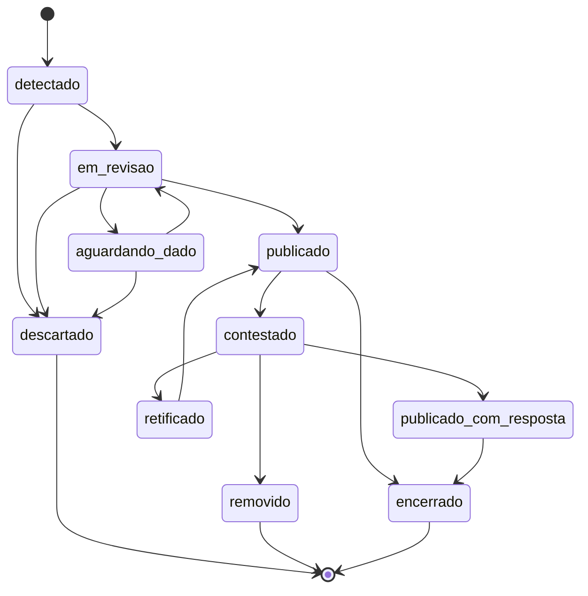

# Banco de dados

Fontes: [DOC-05 Modelo de Dados](https://github.com/Dracon-46/FalkyriaLumen/blob/main/docs/DOC-05_Modelo_de_Dados.docx)
(versão 1.1) e as migrações em
[`packages/canonico/migrations/`](https://github.com/Dracon-46/FalkyriaLumen/tree/main/packages/canonico/migrations).

O Lumen guarda dados em três lugares, cada um com uma garantia
([ADR-005](https://github.com/Dracon-46/FalkyriaLumen/blob/main/docs/adr/ADR-005.md)):

| Onde | O que guarda | Garantia |
|---|---|---|
| Camada bronze (disco ou S3) | Cada artefato exatamente como recebido, com SHA-256, URL, instante e cabeçalhos | Imutável; é a prova |
| Camada silver (JSON Lines particionado) | Fatos administrativos no esquema canônico | Reconstruível do bronze |
| Banco de domínio (PostgreSQL 16) | Fontes, índice do bronze, entes, órgãos, regras, indícios, evidências, revisão, contestação, conformidade e auditoria | Somente-anexação nas tabelas de prova, imposto pelo próprio banco |

O fato administrativo em volume (processos, contratos, itens) fica na silver e, depois, na gold;
o PostgreSQL guarda só o que é transacional e de prova.

## Princípios do modelo

- Existe um único esquema canônico; nenhuma particularidade de fonte vaza para o modelo.
- Todo registro carrega proveniência: de qual artefato bruto veio e quando foi coletado.
- O fato administrativo (contrato, empenho, ato autorizativo) fica separado da interpretação
  (indício), que vive em entidades próprias.
- Campos ausentes são nulos e nunca preenchidos por inferência; ausência alimenta a conformidade.
- Todo campo tem classificação de sensibilidade: **P** dado público de ato administrativo, **PA**
  dado de agente público no exercício da função, **S** dado sensível sujeito a mascaramento.

## Entidades

| Bloco | Entidades | Natureza |
|---|---|---|
| Fato administrativo | Ente, UnidadeGestora, ProcessoContratacao, Contrato, Aditivo, ItemContratado, Empenho, Liquidacao, Pagamento, AtoAutorizativo, AmparoLegal, AgentePublico | Reflete o que o ente publicou; o Lumen não altera nem interpreta |
| Contexto | Fornecedor, Socio, Sancao, CatalogoItem, GrupoPares | Enriquecimento a partir de outras bases públicas |
| Análise e prova | Indicio, RegraDeteccao, Evidencia, DocumentoFonte, Contestacao, Conformidade | Produzido pelo Lumen, sempre rastreável até o fato |

O dicionário completo, campo a campo, está no DOC-05, seção 3.

### O que a Fase 1 implementou

O código está em [`fato.py`](https://github.com/Dracon-46/FalkyriaLumen/blob/main/packages/canonico/lumen_canonico/fato.py)
([ADR-017](https://github.com/Dracon-46/FalkyriaLumen/blob/main/docs/adr/ADR-017.md)):

| Entidade do dicionário | Na Fase 1 | Observação |
|---|---|---|
| Ente | `EnteFederativo`, `Orgao`, `UnidadeGestora` | O PNCP identifica o órgão pelo CNPJ e a unidade pelo código; o ente vem do código IBGE |
| ProcessoContratacao | `ProcessoContratacao` | Com modo de disputa, registro de preço, valores estimado e homologado, situação e sistema de origem |
| ItemContratado | `ItemContratacao` e `ResultadoItem` | Um item pode ter mais de um resultado |
| Contrato | `Contrato` | Valores inicial, global, de parcela e acumulado, como o PNCP publica |
| AmparoLegal | `AmparoLegal` | Código do PNCP ligado ao parâmetro legal datado |
| — | `AtaRegistroPreco` | Atas de registro de preço do PNCP |
| Conformidade (insumo) | `EntregaSiconfi` | O que cada ente entregou ao SICONFI |
| AtoAutorizativo, AgentePublico | Não preenchidas | A API do PNCP não publica quem autorizou o ato |
| Empenho, Liquidacao, Pagamento | Não preenchidas | Dependem do Portal da Transparência e de fontes estaduais |
| Fornecedor | Identificador e documento no resultado e no contrato | A entidade completa depende da base de CNPJ da Receita |

### Identidade determinística

O `id` de todo registro de fato é um UUID versão 5 calculado a partir de um espaço de nomes fixo do
projeto e da chave natural do registro
([`identidade.py`](https://github.com/Dracon-46/FalkyriaLumen/blob/main/packages/canonico/lumen_canonico/identidade.py)).
O mesmo dado coletado duas vezes recebe o mesmo id, em qualquer máquina. Chave com parte nula ou
vazia é recusada.

| Entidade | Chave natural |
|---|---|
| EnteFederativo | Código IBGE (1 para a União, 2 dígitos para estados, 7 para municípios) |
| Orgao | CNPJ |
| UnidadeGestora | CNPJ do órgão e código da unidade |
| AmparoLegal | "pncp" e o código do amparo |
| ProcessoContratacao | `numeroControlePNCP` |
| ItemContratacao | `numeroControlePNCP` do processo e número do item |
| ResultadoItem | `numeroControlePNCP`, número do item e sequencial do resultado |
| Contrato, AtaRegistroPreco | `numeroControlePNCP` do próprio instrumento |
| EntregaSiconfi | Código IBGE, instituição, entregável, exercício e período |
| Fornecedor pessoa jurídica | CNPJ |
| Fornecedor pessoa física | CPF mascarado e nome; nunca o CPF inteiro |

Agentes públicos com o mesmo nome em entes diferentes não são unificados automaticamente: unificar
homônimos sem documento identificador associaria pessoas distintas.

### Qualidade e quarentena

Linha que não pode virar registro canônico vai para a quarentena com fonte, artefato, chave,
posição, campo e valor recebido; o resto do artefato segue. Linha aproveitável com ressalva entra na
silver com marcação de qualidade, como `esfera_nao_informada`, `ente_nao_resolvido`,
`valor_estimado_zero`, `valor_homologado_ausente`, `valor_total_diverge_itens`,
`documento_fornecedor_invalido`, `cnpj_orgao_invalido` e `modalidade_desconhecida`.

## Banco de domínio

### Migrações

| Arquivo | O que faz |
|---|---|
| [`0001_dominio.sql`](https://github.com/Dracon-46/FalkyriaLumen/blob/main/packages/canonico/migrations/0001_dominio.sql) | Schema `lumen` do PostgreSQL, tipos, tabelas, gatilhos, máquina de estados e o papel `lumen_app` |
| [`0002_search_path.sql`](https://github.com/Dracon-46/FalkyriaLumen/blob/main/packages/canonico/migrations/0002_search_path.sql) | Caminho de busca vazio nas três funções de gatilho, apontado pelo linter de segurança do Supabase |

Cada migração registra a si mesma na tabela `migracao`. O teste de banco aplica todas em ordem.

### Tabelas

| Tabela | Conteúdo |
|---|---|
| `migracao` | Versões aplicadas |
| `fonte` | Fontes cadastradas: tipo de conector, objetos, periodicidade, limite de requisições, versão da especificação, campos legais ausentes |
| `documento_fonte` | Índice do bronze: um registro por evento de coleta, com URL solicitada e efetiva, status HTTP, SHA-256, tamanho, tipo de mídia, cabeçalhos, instante, versão, `mudou_desde_anterior` e caminho do objeto |
| `grupo_pares` | Grupos de comparação, com os critérios em JSON |
| `ente_federativo` | Entes, pelo código IBGE (1, 2 ou 7 dígitos), com esfera, UF, população, porte e receita corrente líquida |
| `orgao` | Órgãos, pelo CNPJ (inclusive alfanumérico) |
| `regra_deteccao` | Regras versionadas (código com a letra da família, de A a K, e dois dígitos, como `B-01`), com modo `silencioso` por padrão ou `publicacao` |
| `indicio` | Indícios com regra e versão, alvo, score entre 0 e 1, severidade coerente com o score, estado, parâmetros, valores observados e explicação |
| `evidencia` | Vínculo entre indício e documento fonte, com papel `principal`, `comparacao` ou `contexto` |
| `aprovacao_indicio` | Aprovações por revisor; a chave primária impede contar a mesma pessoa duas vezes |
| `transicao_indicio` | Histórico das mudanças de estado, com autor e justificativa |
| `transicao_permitida` | As transições da máquina de estados |
| `contestacao` | Contestações: protocolo, origem (`ente`, `fornecedor`, `terceiro`), vínculo comprovado, texto como enviado, documentos, marcação pública e desfecho (`mantido`, `retificado`, `removido`) |
| `conformidade` | Avaliações por ente, critério e período, com dispositivo legal e resultado (`cumpre`, `cumpre_parcialmente`, `nao_cumpre`, `indeterminado`) |
| `trilha_auditoria` | Ações com autor, entidade, justificativa e dados |

### Garantias impostas pelo banco

As mesmas regras já existem na aplicação (`lumen_canonico.indicio`, `lumen_ingestao.portas`).
Repeti-las no banco é defesa em profundidade: um script de manutenção ou uma API nova não as
contornam por descuido.

| Garantia | Como o banco impõe |
|---|---|
| Prova e auditoria somente-anexação (RNF-15) | Gatilhos recusam UPDATE e DELETE em `documento_fonte`, `evidencia`, `aprovacao_indicio`, `transicao_indicio` e `trilha_auditoria`, e TRUNCATE em `documento_fonte` e `trilha_auditoria` |
| Indício só publicado com evidência e revisores distintos | Transição validada contra `transicao_permitida`; severidade baixa nunca entra em revisão nem é publicada; publicar exige ao menos uma evidência e 1 revisor (média) ou 2 revisores distintos (alta); o revisor nunca é "sistema" |
| Conteúdo do indício imutável | Fora o estado e o protocolo de contestação, nada muda depois de criado; o indício não pode ser apagado. Retificar é republicar com nova versão de regra |
| Conformidade indeterminada exige motivo (RF-CF-07) | Restrição de verificação: `indeterminado` exige `motivo_indeterminado`, e os demais resultados o proíbem |
| Defesa em profundidade | A aplicação conecta com o papel `lumen_app`, que não recebe UPDATE nem DELETE nas tabelas de prova |

### Máquina de estados do indício



Transições da tabela `transicao_permitida`, iguais às de `lumen_canonico.indicio.TRANSICOES`.
Descartado, removido e encerrado são terminais.

### Onde roda

- **Local e CI:** PostgreSQL 16. A CI aplica as migrações num serviço descartável a cada push e PR.
- **Nuvem:** previsto no Supabase gratuito (500 MB de banco), numa organização própria do projeto,
  nunca na de uma empresa que o mantenedor atende
  ([ADR-026](https://github.com/Dracon-46/FalkyriaLumen/blob/main/docs/adr/ADR-026.md)). O projeto
  ainda não foi criado (README, "Pendente").

## Camada silver

Gravada em JSON Lines no particionamento Hive (`<entidade>/exercicio=AAAA/uf=XX/<documento>.jsonl`),
um arquivo por artefato do bronze e partição, com troca atômica: reprocessar produz os mesmos bytes.
Cada linha leva a versão do normalizador e o instante da coleta. A silver guarda todas as
ocorrências de um registro; a visão consolidada escolhe uma por id (a de `atualizado_em` mais
recente, depois a coleta mais recente):

```bash
duckdb -c ".read packages/normalizacao/sql/silver_consolidada.sql" \
       -c "SELECT * FROM silver_consolidada('dados/silver', 'contratacao') LIMIT 10"
```

## PostgreSQL local

[`infra/docker-compose.yml`](https://github.com/Dracon-46/FalkyriaLumen/blob/main/infra/docker-compose.yml)
sobe o ambiente local completo:

| Serviço | Endereço | Uso |
|---|---|---|
| PostgreSQL 16 | `localhost:5432`, usuário `lumen`, banco `lumen` | Banco de domínio; as migrações de `packages/canonico/migrations` rodam na primeira subida |
| MinIO (S3) | `http://localhost:9000` | Camada bronze, bucket `lumen-bronze` com Object Lock e versionamento |
| Console do MinIO | `http://localhost:9001` | Inspeção dos objetos |

A senha do ambiente local está no `docker-compose.yml`, de propósito: é só de desenvolvimento.
Fora da máquina local, credenciais vêm de cofre de segredos (RNF-13).

```bash
make ambiente   # docker compose -f infra/docker-compose.yml up -d
make banco      # testes marcados "postgres" contra o banco do ambiente (exige o cliente psql)
```

As migrações só rodam automaticamente quando o volume do PostgreSQL está vazio (primeira subida).
Para recomeçar do zero em desenvolvimento:

```bash
docker compose -f infra/docker-compose.yml down -v
```

Isso apaga os volumes, inclusive a prova guardada no MinIO. Só faça em desenvolvimento.

Para usar o bronze no MinIO a partir do Python, veja o
[README de infra](https://github.com/Dracon-46/FalkyriaLumen/blob/main/infra/README.md). Sem
Docker, o pipeline funciona igual com o backend local (`ArmazemBronzeLocal`), que é o padrão do
comando `lumen`.

## Particionamento e retenção (DOC-05, seção 7)

| Camada | Particionamento | Retenção |
|---|---|---|
| Bronze | Por fonte, ano e mês de coleta | Permanente; é a prova |
| Silver | Por entidade, exercício e UF | Regerável |
| Gold | Por exercício e tipo de agregado | Recalculada a cada mudança de regra ou linha de base |
| Domínio | Sem particionamento na fase inicial | Permanente, com backup testado |
| Auditoria | Por mês | Permanente e somente-anexação |
